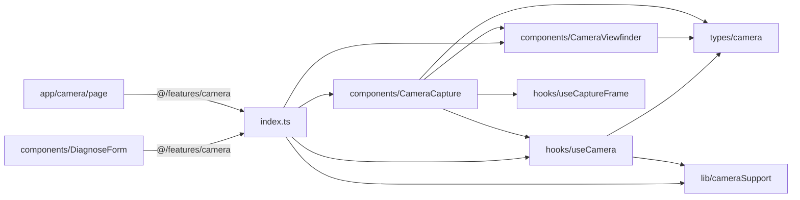
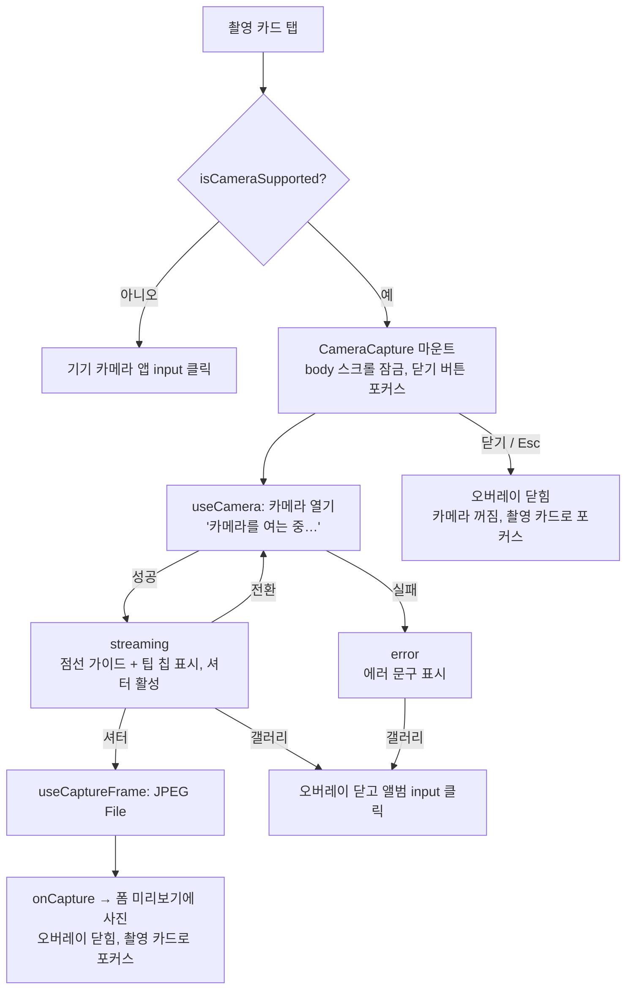
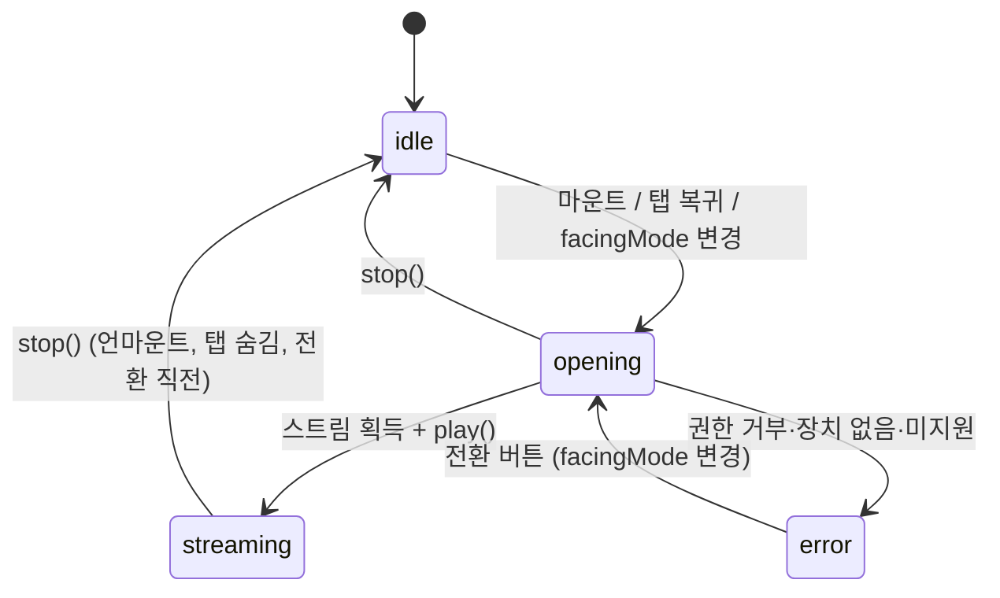

# 카메라 파트 구현 현황 — `features/camera/`

> 담당: 고명준 (CAM) · 작성일: 2026-09-24 · 브랜치: `fe/camera` (미커밋)
> 기준 문서: [14_카메라_파트_구현_기획](14_카메라_파트_구현_기획.md) · [06_웹앱_기능명세서](06_웹앱_기능명세서.md) M01-F2·F3 · Figma "V-02 뷰파인더"(node `264:226`)
> 이 문서는 **지금 코드가 실제로 어떻게 동작하는지**를 설명한다. 계획은 14번 문서, 현재 상태는 이 문서를 본다.

---

## 1. 한눈에 보기

### 1.1 지금 되는 것

- 진단 폼(홈)의 **촬영 카드**를 누르면 폼 위에 풀스크린 카메라(뷰파인더)가 뜬다.
- 후면 카메라 우선, **전면/후면 전환**, 전면일 때 미리보기 **좌우 반전(거울)**.
- **셔터**를 누르면 현재 프레임을 JPEG로 찍어 폼의 미리보기 카드에 넣고 카메라를 닫는다.
- 촬영 카드 아래 **"앨범에서 사진 선택"**, 뷰파인더의 **갤러리 버튼**으로 앨범 사진을 고를 수 있다.
- http 접속·미지원 브라우저에서는 뷰파인더 대신 **기기 카메라 앱**(`capture="environment"`)으로 넘어간다.
- 권한 거부·장치 없음 등은 **에러 문구**로 안내하고, 갤러리 버튼으로 대체할 수 있다.
- 앱을 백그라운드로 보내면 카메라를 끄고, 돌아오면 다시 켠다 (카메라 LED·배터리).
- Figma V-02 디자인: 진녹색 배경, 작물 칩, 노란 점선 가이드, 팁 칩, 갤러리·셔터·전환 버튼.

### 1.2 아직 안 되는 것 (14번 기획 대비)

| 기획 항목 | 상태 | 비고 |
|---|---|---|
| M-02b 미리보기 화면 (다시 찍기 / 진단하기) | ❌ | 지금은 찍으면 바로 폼 미리보기 카드로 들어감 |
| 리사이즈 (긴 변 1280px, EXIF 보정) | ❌ | `lib/resizeImage.ts` 미작성 |
| 파일 검증 (JPEG/PNG, 10MB) | ✅ | `lib/validateImage.ts` — 실패 시 토스트 안내 |
| 밝기·흔들림 가이드 배지 | ❌ | 점선 프레임 + 팁 문구만 있음 |
| 재촬영 모드 (`RecapturePanel` 연결) | ❌ | `RecapturePanel`은 예전 `<input capture>` 방식 그대로 |
| 권한 거부 시 전용 폴백 화면 (`FileFallback`) | △ | 에러 문구 + 갤러리 버튼으로 대체 중 |
| Vitest 단위 테스트 | ❌ | 프론트에 테스트 러너 없음 |

### 1.3 기획서 8절 PR 순서 기준 진행도

| 순서 | 브랜치(기획) | 내용 | 상태 |
|---|---|---|---|
| 1 | `cam/capture-contract` | `types/camera.ts`, `index.ts` | ✅ (최소 계약만) |
| 2 | `cam/live-preview` | `useCamera`, `CameraViewfinder`, `useCaptureFrame`, `CameraCapture`, `FileFallback` | ✅ (`FileFallback` 제외) |
| 3 | `cam/image-pipeline` | 리사이즈·검증 | △ (검증만 완료) |
| 4 | `cam/capture-guide` | 가이드 배지 | △ (정적 프레임만) |
| 5 | `cam/diagnose-form-integration` | `DiagnoseForm` 연결 | ✅ (FE 리뷰 필요) |
| 6 | `cam/recapture-mode` | 재촬영 모드 | ❌ |

---

## 2. 파일 구조

```
frontend/
├── public/camera/leaf.svg                 # Figma 잎 일러스트 원본 (작물 칩 아이콘)
├── tailwind.config.js                     # photo.deep / photo.leaf-light / scrim 색 토큰 추가
└── src/
    ├── features/camera/                   # CAM 소유
    │   ├── index.ts                       # 외부 공개 표면 (여기서만 import, 타입도 재export)
    │   ├── components/
    │   │   ├── CameraCapture.tsx          # 진입 컴포넌트: 훅 + 뷰파인더 조립, 오버레이 동작
    │   │   └── CameraViewfinder.tsx       # 화면(UI)만: 상단 바·video·가이드·하단 버튼
    │   ├── hooks/
    │   │   ├── useCamera.ts               # getUserMedia 스트림 생명주기
    │   │   └── useCaptureFrame.ts         # video → canvas → JPEG File
    │   └── lib/
    │       └── cameraSupport.ts           # isCameraSupported() 순수 판별
    ├── types/camera.ts                    # 카메라 공용 타입 (types/diagnosis.ts와 같은 위치)
    ├── components/
    │   ├── DiagnoseForm.tsx               # (FE 소유) 촬영 카드·앨범 버튼·오버레이 연결
    │   ├── AppBar.tsx / BottomNav.tsx     # (FE 소유) /camera에서 숨김
    └── app/camera/page.tsx                # 개발용 단독 뷰파인더 페이지 (셔터 없음)
```

### 2.1 의존 방향



- 바깥(`DiagnoseForm`, `/camera`)은 **`@/features/camera`(index.ts)로만** 가져간다. 내부 파일 경로가 바뀌어도 바깥 코드는 안 바뀐다.
- 모듈 안은 `components/`(UI) · `hooks/` · `lib/`로 나눈다. UI → hooks → lib 방향으로만 import한다. `lib/`는 React를 모르는 순수 함수라 나중에 단위 테스트 대상이 된다 (기획서 3절 규칙).
- 타입은 프로젝트 공용 타입 폴더 `src/types/camera.ts`에 둔다 (2026-09-24 이동, 기획서 3절의 `features/camera/types.ts`에서 변경). 모듈 안에서는 `@/types/camera`로, 바깥에서는 `@/features/camera`의 재export로 가져간다.
- `CameraViewfinder`는 **화면만** 그린다. 카메라를 직접 열지 않고, 상태(`status`, `error`)와 콜백을 props로 받는다. 그래서 `/camera` 페이지와 `CameraCapture` 두 곳에서 같은 화면을 재사용한다.

---

## 3. 사용자 흐름

### 3.1 진입점 두 개 (기능명세서 M01-F2·F3)

```
[홈 / 진단 폼]
┌────────────────────────┐
│     📷 사진 촬영하기      │ ─┬─ 카메라 사용 가능 ─► 풀스크린 뷰파인더 (CameraCapture)
└────────────────────────┘  └─ http·미지원 ─────► 기기 카메라 앱 (<input capture="environment">)
      앨범에서 사진 선택 ›    ───────────────────► 앨범 (<input accept="image/jpeg,image/png">)
```

선택 다이얼로그(카메라/앨범 고르기)는 두지 않았다. 기획서가 두 진입점을 따로 정의하고 있고, 사용자 결정(2026-09-24)으로 기획서를 따랐다.

### 3.2 뷰파인더 안에서



---

## 4. 모듈별 상세

### 4.1 `src/types/camera.ts` — 공용 타입

| 타입 | 값 | 쓰는 곳 |
|---|---|---|
| `CameraStatus` | `"idle" \| "opening" \| "streaming" \| "error"` | 훅 상태, 뷰파인더 표시 분기 |
| `CameraErrorCode` | `"permission-denied" \| "not-supported" \| "no-device" \| "play-failed" \| "unknown"` | 에러 분류, 문구 매핑 |
| `FacingMode` | `"user" \| "environment"` | 전면/후면 |
| `CaptureMeta` | `{ source: "camera" \| "file"; width; height }` | `onCapture` 두 번째 인자 |
| `CameraCaptureProps` | `onCapture`, `onClose`, `onCaptureError?`, `notice?`, `onGallery?`, `cropLabel?` | `CameraCapture` props |

기획서 4절 계약(`mode`, `regionLabel`, `maxLongEdge`, `fallbackToFile`, `onError`, `onOpenChange`)은 **아직 필요한 것만** 넣었다. 재촬영 모드·리사이즈를 붙일 때 추가한다. `CameraErrorCode`의 `invalid-file`도 파일 검증을 붙일 때 추가한다.

### 4.2 `lib/cameraSupport.ts` — 카메라를 쓸 수 있는 환경인가

```ts
export function isCameraSupported() {
  return (
    typeof window !== "undefined" &&           // SSR(서버 렌더링) 중이 아님
    window.isSecureContext &&                   // https 또는 localhost
    typeof navigator.mediaDevices?.getUserMedia === "function"
  );
}
```

- **왜 필요한가**: `getUserMedia`는 보안 컨텍스트(https, localhost)에서만 동작한다. 팀원이 폰으로 `http://192.168.x.x:3000`에 접속하면 `navigator.mediaDevices` 자체가 없다.
- **두 곳에서 쓴다**:
  1. `useCamera.start()` — false면 권한 요청 없이 바로 `not-supported` 에러.
  2. `DiagnoseForm.openCamera()` — false면 오버레이를 아예 열지 않고 기기 카메라 앱으로 보낸다.

### 4.3 `hooks/useCamera.ts` — 카메라 스트림 생명주기

**사용법**

```ts
const { videoRef, status, error, activeFacingMode, start, stop } = useCamera({ facingMode });
// <video ref={videoRef} playsInline muted autoPlay />
```

| 반환값 | 의미 |
|---|---|
| `videoRef` | `<video>`에 붙이는 ref. 훅이 여기에 스트림을 연결한다 |
| `status` | `idle` → `opening` → `streaming` 또는 `error` |
| `error` | `status === "error"`일 때 원인 코드 |
| `activeFacingMode` | **실제로 열린** 카메라 방향 (요청값과 다를 수 있음). 미러 판단에 사용 |
| `start` / `stop` | 수동 제어용. 보통은 마운트/언마운트로 자동 처리되어 쓸 일 없음 |

#### 4.3.1 상태 전이



#### 4.3.2 카메라 여는 과정 (`start`, 66행~)

1. `requestId = ++requestIdRef.current` — 이번 요청 번호를 받는다.
2. 기존 스트림 정리(`releaseStream`), `activeFacingMode = null`.
3. `isCameraSupported()`가 false면 `error = "not-supported"`로 끝.
4. `status = "opening"`.
5. `openStream(facingMode)`로 `getUserMedia` 호출:
   ```ts
   { video: { facingMode: { ideal: facingMode }, width: { ideal: 1280 }, height: { ideal: 720 } }, audio: false }
   ```
   - `exact`가 아닌 **`ideal`**: iOS에서 `exact`는 실패가 잦다 (기획서 7절).
   - `OverconstrainedError`가 나면 조건 없이 `{ video: true }`로 한 번 더 요청.
6. 스트림이 도착했는데 요청 번호가 바뀌었으면(그사이 닫힘·전환) **스트림을 즉시 끄고 버린다**.
7. 실제 방향을 읽는다: `track.getSettings().facingMode`. 값이 없으면(데스크톱 웹캠 등) 요청값으로 대신한다. **영상 연결 전에** 정해서 전면 카메라가 반전 없이 잠깐 보이는 깜빡임을 막는다.
8. `video.srcObject = stream` → `await video.play()` (autoPlay가 막히는 브라우저 대비). 요청 번호가 바뀌어 중단된 경우는 조용히 끝내고, 그 밖의 실패로 영상이 멈춰 있으면 `error = "play-failed"`. 스트림은 남겨 두고, 에러 화면의 "다시 시도"(`retry()`)가 클릭 핸들러 안에서 바로 `video.play()`를 다시 부른다(getUserMedia를 기다리면 사용자 제스처가 만료될 수 있어서). 그래도 실패하거나 스트림이 없으면 `start()`로 처음부터 연다.
9. `play()` 사이에도 요청 번호를 다시 확인한 뒤 `status = "streaming"`.

#### 4.3.3 에러 분류 (`toErrorCode`)

| 브라우저 에러 이름 | 코드 | 화면 문구 |
|---|---|---|
| `NotAllowedError`, `SecurityError` | `permission-denied` | 카메라 권한이 필요해요. 브라우저 설정에서 권한을 허용해 주세요. |
| `NotFoundError` | `no-device` | 카메라를 찾을 수 없어요. |
| (보안 컨텍스트 아님) | `not-supported` | 이 환경에서는 카메라를 쓸 수 없어요. HTTPS로 접속했는지 확인해 주세요. |
| (`video.play()` 거부, 영상 멈춤) | `play-failed` | 카메라 화면을 띄우지 못했어요. 다시 시도해 주세요. |
| 그 외 (`NotReadableError` 등) | `unknown` | 카메라를 사용할 수 없어요. 다른 앱이 카메라를 쓰고 있는지 확인해 주세요. |

#### 4.3.4 경쟁 조건 방지 — `requestIdRef`

`getUserMedia`는 비동기라, 기다리는 사이에 사용자가 닫거나 전환할 수 있다. `start()`와 `stop()`은 모두 요청 번호를 올리고, 스트림이 도착했을 때 번호가 다르면 그 스트림은 버린다. 이것으로 막는 상황:

- React StrictMode(개발 모드)의 effect 이중 실행 → 첫 번째 스트림이 새지 않음.
- 전환 버튼 연타 → 늦게 도착한 이전 카메라 스트림 폐기.
- 여는 중에 오버레이 닫기 → 닫힌 뒤 카메라가 켜지는 일 없음.

`retry()`는 요청 번호를 올리지 않고 현재 번호를 기억해 두었다가, `play()`가 끝났을 때 번호가 그대로일 때만 결과를 반영한다. 재생이 또 실패하면 탭이 보일 때만 `start()`로 넘어간다. `play-failed` 뒤 브라우저가 스스로 재생을 시작하면(`playing` 이벤트) 에러 화면을 거두고 `streaming`으로 바꾼다.

#### 4.3.5 백그라운드 처리 — `visibilitychange` (113행~)

| 상황 | 동작 |
|---|---|
| 탭이 숨겨짐 + 카메라가 켜져 있거나 여는 중 | `stop()`으로 끄고 "돌아오면 다시 켤 것" 표시 |
| 탭이 숨겨짐 + 에러 상태 | 에러 문구 유지. `play-failed`로 남겨 둔 스트림을 끄고 요청 번호를 올려 진행 중인 `retry()`도 무효화 |
| 탭으로 돌아옴 + 표시가 있음 | `start()`로 다시 켬 |
| 페이지가 처음부터 백그라운드 탭에서 열림 | 켜지 않고 표시만 해 둠 → 보일 때 켬 |

에러 상태에서 돌아올 때 다시 켜지 않는 이유: Safari·Firefox는 권한 거부를 기억하지 않아서, 다시 요청하면 **탭을 오갈 때마다 권한 팝업**이 뜬다. 기획서 7절 "재요청 버튼은 두지 않음"과 같은 취지.

`statusRef`는 이벤트 핸들러가 최신 `status`를 읽기 위한 사본이다 (state는 클로저에 옛 값이 갇힌다).

### 4.4 `hooks/useCaptureFrame.ts` — 셔터

```ts
const { capture } = useCaptureFrame();
const result = await capture(videoElement);
// { ok: true, file, width, height } | { ok: false, reason: "busy" | "not-ready" | "encode-failed" }
```

1. 캡처 중이면 `busy`, `video.videoWidth/Height`가 0이면(영상 준비 전) `not-ready`.
2. `object-cover`로 **화면에 보이는 영역만** 계산한다(`video.clientWidth/Height` 비율로 원본 가운데를 자름). 그 크기의 `<canvas>`에 `drawImage` 9인자로 그린다. `className`의 `object-cover`·가운데 정렬을 바꾸면 이 계산도 맞춰야 한다.
3. `canvas.toBlob(resolve, "image/jpeg", 0.85)` → `File("capture-<시각>.jpg")`. `getContext`·`toBlob` 실패는 `encode-failed`.
4. `CameraCapture`는 `busy`(셔터 연타)는 무시하고, 나머지 실패는 `onCaptureError`로 "사진을 만들지 못했어요. 다시 찍어 주세요"를 알린 채 오버레이를 유지한다. 토스트는 `notice`로 받아 **오버레이(dialog) 안 상단**에 띄운다 — `aria-modal` 밖의 live region은 스크린리더가 무시할 수 있고, 하단에 두면 셔터를 가려서. 카메라를 닫을 때 `clearToast()`로 비워 하단에 다시 뜨지 않게 한다.

- **미러는 저장되지 않는다**: 전면 카메라 반전은 `<video>`의 CSS(`-scale-x-100`)라 `drawImage` 결과에는 원본 방향 그대로 들어간다. 진단 이미지는 실제 방향이어야 한다.
- **해상도**: 스트림(`ideal 1280×720`)에서 화면에 보이는 부분만큼. 세로 화면이면 가로 스트림의 좌우가 잘려 대략 405×720 근처가 된다.
- **연타 방지**: `busyRef`(렌더를 기다리지 않는 즉시 잠금). 셔터는 캡처 중에도 비활성화하지 않는다(누른 버튼의 포커스가 빠지므로).

### 4.5 `CameraViewfinder.tsx` — 화면

**Props**

| prop | 설명 |
|---|---|
| `videoRef`, `status`, `error` | `useCamera` 결과 그대로 |
| `cropLabel?` | 상단 칩 "{cropLabel} 잎". 없으면 칩 숨김 |
| `mirrored?` | true면 `<video>` 좌우 반전 |
| `onClose`, `onFlip` | 닫기, 전환 |
| `onRetry?` | 에러 화면 "다시 시도" 버튼 (권한 거부·미지원에는 표시 안 함) |
| `notice?` | 오버레이 안 상단에 띄울 토스트 |
| `onShutter?`, `onGallery?` | **안 넘기면 버튼 비활성** (`/camera` 개발 페이지가 이 상태) |

**레이아웃** (위→아래, `max-w-app` 30rem 가운데 정렬, 바깥 여백은 `bg-paper`)

| 영역 | 구성 | Figma 대응 |
|---|---|---|
| 상단 바 (`min-h-[52px]`, safe-area 상단 포함) | 닫기 X · 작물 칩 · 균형용 빈칸 | 상단 Frame (264:232) |
| 뷰파인더 (`flex-1`) | `<video object-cover>` + 가이드 오버레이 + 상태/에러 문구 | viewfinder (264:238) |
| 하단 컨트롤 (3칸 grid, safe-area 하단 포함) | 갤러리 44px · 셔터 80px · 전환 | 하단 Frame (264:244) |

Figma 목업의 상태바(9:41, LTE)와 홈 인디케이터는 OS가 그리는 부분이라 구현하지 않았다. 목업 속 잎 그림은 카메라 영상 자리표시라 실제로는 `<video>`가 들어간다.

**가이드 크기 계산**

```
height = min(400px, 100cqh − 6rem, (100cqw − 5.625rem) × 4/3),  aspect-ratio 3/4
```

- 오버레이 div에 `container-type: size`를 줘서 `cqh`/`cqw`(오버레이 높이·폭 기준 %)를 쓴다.
- 디자인 크기 300×400을 넘지 않고, 팁 칩 자리(6rem)를 뺀 높이와 좌우 여백(5.625rem)을 뺀 폭 안에 들어가도록 **3:4를 유지한 채** 줄어든다.
- `aspect-ratio` + `max-w` + `max-h` 조합은 한쪽이 잘릴 때 비율이 깨져서 이 방식을 택했다.

**상태별 표시**

| status | 화면 |
|---|---|
| `opening` | 가운데 "카메라를 여는 중…" (`role="status"` 영역은 항상 존재, 문구만 바뀜) |
| `streaming` | 노란 점선 가이드 + "잎 한 장이 노란 선 안에 꽉 차게" 팁 칩, 셔터 활성 |
| `error` | 에러 문구 (`role="alert"`) |

**버튼 상태**

| 버튼 | 비활성 조건 | 방식 |
|---|---|---|
| 갤러리 | `onGallery` 없음 | `disabled` + `opacity-60` |
| 셔터 | `onShutter` 없음 또는 `status !== "streaming"` (캡처 중 연타는 `busy` 잠금이 무시) | `disabled` + `opacity-60` |
| 전환 | `status === "opening"` (연타 시 일부 안드로이드 `NotReadableError`) | `aria-disabled` + 클릭 무시 — `disabled`는 누른 버튼의 포커스를 날려서 |

**접근성**

- 루트 `role="dialog" aria-modal="true" aria-label="카메라 촬영"`, 열리면 닫기 버튼에 포커스.
- `useFocusTrap`: 열려 있는 동안 Tab·Shift+Tab이 오버레이 안 버튼만 순환한다.
- 닫기·전환 아이콘(26·28px)은 그대로 두고 **터치 영역은 44px**(`h-11 w-11`). 음수 마진으로 아이콘 위치는 디자인과 동일하게 유지.
- 작물 칩은 최대 폭 65% + 말줄임.
- 팁 칩은 좁은 화면 + 큰글씨 모드에서 잘리지 않고 두 줄로 넘어간다.

**색 토큰** (`tailwind.config.js`)

| 토큰 | 값 | 용도 |
|---|---|---|
| `photo-deep` | `#1E3326` | 뷰파인더 배경 |
| `photo-leaf-light` | `#8DB36A` | 갤러리 썸네일 자리 |
| `scrim` | `#0F1A12` | 작물 칩(85%)·팁 칩 배경 |
| `brand` (기존) | `#F5B301` | 점선 가이드·전구 아이콘 |

아이콘: `icon-[lucide--x]`, `icon-[lucide--lightbulb]`, `icon-[lucide--flip-horizontal]` (Figma SVG와 경로 동일 확인).

### 4.6 `CameraCapture.tsx` — 진입 컴포넌트

```tsx
{cameraOpen && (
  <CameraCapture cropLabel="무" onCapture={…} onClose={…} onGallery={…} />
)}
```

**마운트 = 카메라 켜짐, 언마운트 = 카메라 꺼짐.** `open` prop 없이 조건부 렌더링으로 연다.

하는 일:

| 기능 | 구현 |
|---|---|
| 카메라 | `useCamera({ facingMode })`, 전환 버튼은 `facingMode` 토글 → 훅이 알아서 재오픈 |
| 미러 | `mirrored = activeFacingMode === "user"` |
| 셔터 | `useCaptureFrame().capture(video)` → `onCapture(file, { source: "camera", width, height })` |
| 스크롤 잠금 | 마운트 시 `body.style.overflow = "hidden"`, 언마운트 시 원래 값 복원 |
| Esc | `keydown` 리스너 → `onClose()` |
| 캡처 중 닫힘 | `mountedRef`로 확인해, 닫힌 뒤 도착한 사진은 `onCapture`하지 않음 |

### 4.7 `DiagnoseForm.tsx` 연결 (FE 소유 파일)

| 변경 | 이유 |
|---|---|
| `fileRef` → `file` state | 카메라로 찍은 `File`은 `<input type=file>`에 넣을 수 없다 |
| 촬영 카드 `<label>` → `<button onClick={openCamera}>`, 문구 "사진 촬영하기" | 파일 입력 대신 카메라 오버레이를 연다 |
| "앨범에서 사진 선택 ›" 버튼 + 숨은 input (`accept="image/jpeg,image/png"`, capture 없음) | M01-F3 갤러리 선택. `capture`가 없어야 앨범이 열린다 |
| 숨은 fallback input (`accept="image/*" capture="environment"`) | 카메라 미지원 환경에서 촬영 카드가 여는 기기 카메라 앱 |
| `selectFile(file)` | 파일/카메라 두 경로 공통: `file`·`preview` 세팅, 이전 결과·에러 초기화 |
| `useEffect(() => () => URL.revokeObjectURL(preview), [preview])` | 사진이 바뀌거나 화면을 떠날 때 이전 미리보기 URL 해제 (메모리 누수 방지) |
| input `onChange`에서 `e.target.value = ""` | 같은 사진을 다시 골라도 `onChange`가 불리게 |
| `closeCamera()` → `captureCardRef.focus()` | 오버레이를 닫으면 포커스를 촬영 카드로 돌려준다 |
| `handleCameraGallery()` → 닫고 `galleryInputRef.click()` | 뷰파인더 갤러리 버튼. 클릭 핸들러 안에서 **동기로** `click()`해야 iOS가 막지 않는다 |
| `cropLabel={cropType \|\| undefined}` | 작물 선택값 → 칩. "자동 감지"(`""`)면 칩 숨김 |

`handleSubmit`은 `file` state를 `diagnoseImage(file, cropType)`로 보낸다. 진단 API·결과 표시·`RecapturePanel`은 그대로다.

### 4.8 `/camera` 개발 페이지 · 네비게이션

- `app/camera/page.tsx`: `CameraViewfinder` + `useCamera`만으로 뷰파인더를 단독으로 띄운다. `?crop=무`로 작물 칩 표시, 닫기는 `/`로 이동. **셔터·갤러리를 넘기지 않아 비활성** — 실기기에서 카메라 열기·전환·미러만 확인하는 용도.
- `useSearchParams`를 `<Suspense>`로 감쌌다 (Next 15 정적 렌더링 요구사항).
- `AppBar`·`BottomNav`: "촬영" 탭은 제거했다 (촬영은 진단 폼에서 한다). `/camera`는 내비게이션에 노출되지 않는 URL 직접 접근용 개발 페이지이고, 이 경로에서는 둘 다 렌더하지 않는다.

---

## 5. 브라우저 호환 · 주의사항

| 항목 | 내용 |
|---|---|
| HTTPS 필수 | 폰 테스트는 `next dev --experimental-https` 또는 ngrok. http LAN이면 자동으로 기기 카메라 앱으로 넘어감 |
| iOS Safari | `<video playsInline muted autoPlay>` 세 속성이 모두 있어야 인라인 재생. `facingMode`는 `ideal` |
| 전면 카메라 방향 | `getSettings().facingMode`를 안 주는 기기(데스크톱 웹캠 등)는 요청값으로 판단. 노트북에서 후면을 요청했는데 전면 캠이 열리면 미러가 안 됨 |
| 컨테이너 쿼리 단위 | 가이드 크기에 `cqh`/`cqw` 사용 — iOS Safari 16+, Chrome 105+. 그 이하에서는 가이드가 안 보임(크래시 없음) |
| `next build` | 개발 서버(`npm run dev`)가 켜져 있을 때 돌리면 같은 `.next`를 덮어써 dev 서버가 500을 낸다. 빌드는 dev 서버를 끄고 |

---

## 6. 확인 방법

**자동 검사** (`frontend/`)

```bash
npx tsc --noEmit
npx next lint --dir src
npx prettier --check src/features/camera src/components/DiagnoseForm.tsx
```

**수동 체크리스트**

| # | 확인 | 기대 결과 |
|---|---|---|
| 1 | 홈 → "사진 촬영하기" | 풀스크린 뷰파인더, 후면 카메라, 닫기 버튼에 포커스 |
| 2 | 작물 "무" 선택 후 촬영 | 상단에 "무 잎" 칩. "자동 감지"면 칩 없음 |
| 3 | 셔터 | 폼 미리보기에 사진, 오버레이 닫힘, "AI 진단 시작"으로 제출 가능 |
| 4 | 전환 | 전면으로 바뀌고 거울처럼 반전. 찍은 사진은 반전 안 됨 |
| 5 | 여는 중 전환 연타 | 전환 버튼 흐리게, 에러 없음 |
| 6 | 권한 거부 | 에러 문구, 갤러리 버튼으로 앨범 선택 가능 |
| 7 | 닫기 / Esc | 오버레이 닫힘, 카메라 LED 꺼짐, 포커스가 촬영 카드로 |
| 8 | 촬영 중 홈 버튼으로 앱 전환 후 복귀 | 나가면 카메라 꺼지고 돌아오면 다시 켜짐 |
| 9 | "앨범에서 사진 선택" | 앨범 열림, 고른 사진이 미리보기에 |
| 10 | http LAN 접속에서 촬영 카드 | 기기 카메라 앱이 열림 |
| 11 | 320×568 + 큰글씨 모드 | 가이드 3:4 유지, 팁 칩 두 줄, 겹침 없음 |
| 12 | `/camera?crop=무` | 단독 뷰파인더 (셔터·갤러리 비활성) |

---

## 7. 알려진 한계 · 다음 작업

리뷰(reviewer 에이전트)에서 나왔지만 아직 반영하지 않은 것들.

| 중요도 | 내용 | 제안 |
|---|---|---|
| 중 | 권한 거부 시 앨범 유도가 약함 (글자 없는 연두색 네모 버튼뿐) | 에러 문구 아래 "앨범에서 사진 선택" 텍스트 버튼 (기획서 7절) |
| 중 | 보이는 영역만 crop 저장은 반영했지만 실기기(세로 화면 + 가로 스트림)에서 결과 사진 확인 필요 | 폰 2~3대로 확인 |
| 중 | "다시 시도"가 자동재생 차단을 실제로 푸는지 iOS Safari 실기기 확인 필요 | 저전력 모드 등에서 재현 |
| 낮음 | 가이드 크기의 `cq` 단위 미지원 구형 브라우저 | 필요하면 대체 높이 선언 추가 |
| 기획 | M-02b 미리보기, 리사이즈, 가이드 배지, 재촬영 모드, Vitest | 기획서 8절 3·4·6번 |

---

## 8. 작업 이력 (2026-09-23 ~ 10-04)

1. `useCamera` 훅 + `/camera`에서 `<video>` 표시.
2. 리뷰 반영: `play()` 후 요청 번호 재확인, 에러 상태에서 탭 복귀 시 재요청 안 함, 백그라운드 탭 마운트 처리.
3. Figma V-02 디자인 반영: `CameraViewfinder`, 색 토큰, `leaf.svg`, `/camera` 풀스크린(AppBar·BottomNav 숨김).
4. 리뷰 반영: 전면 미러, 비활성 버튼 표시, 터치 영역 44px, 전환 연타 방지, 가이드 3:4 유지, 팁 칩 줄바꿈, 작물 칩 말줄임, `role="status"`, 셔터 정중앙(grid).
5. 진단 폼 통합: `types`·`index`·`cameraSupport`·`useCaptureFrame`·`CameraCapture` 신설, `DiagnoseForm`에 촬영 카드 → 오버레이, "앨범에서 사진 선택", 미지원 폴백, `file` state 전환.
6. 리뷰 반영: 캡처 중 닫으면 사진을 넘기지 않음.
7. 폴더 구조 정리: 타입 `features/camera/types.ts` → `src/types/camera.ts` (프로젝트 `types/` 폴더 구조에 맞춤), 컴포넌트 `CameraCapture`·`CameraViewfinder` → `features/camera/components/`.
8. 외부 검토 반영: 보이는 영역만 저장(crop), 포커스 트랩(`useFocusTrap`), `play()` 실패 시 `play-failed` + 다시 시도(`retry`), 캡처 실패 토스트(오버레이 안 상단), 셔터 포커스 유지.
9. PR 리뷰 반영 (2026-10-04): `AppBar`·`BottomNav`에서 "촬영" 탭 제거(`/camera`는 개발용으로 유지), 업로드 허용 형식을 백엔드 PR #20·#21의 JPEG/PNG 계약에 맞춰 한정(`validateImage`, 앨범 input `accept`).

**커밋 시 권장 분할** (기획서 8절, PR 300줄 규칙):
① `features/camera/` + `public/camera/` + `tailwind.config.js` (CAM 단독),
② `DiagnoseForm.tsx` 연결 (FE 리뷰어 지정),
③ `AppBar`/`BottomNav` 정리 ("촬영" 탭 제거 완료, `app/camera`는 개발용으로 유지).
